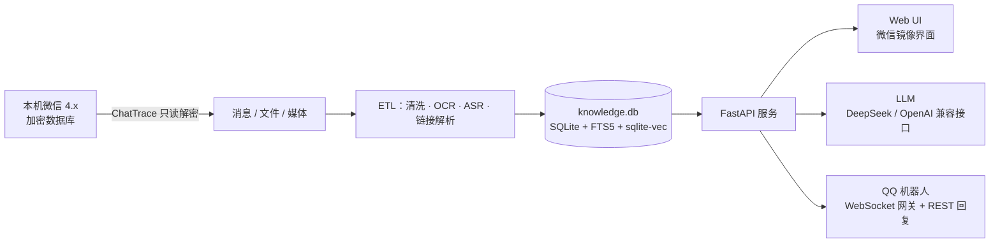

<div align="center">

# 微信知识助手

**把本机微信聊天记录变成可搜索、可引用、可问答的私人知识库。**

全程本地运行 · 只读解密 · 不向微信发送任何消息


</div>

---

## 为什么需要它

微信里沉淀着真实的个人知识：私聊结论、群里的文件、语音里说过的地址、截图里的报错、收藏的文章。但你多半经历过这些时刻：

- **语音里的关键信息找不回来**：朋友在语音里说过一个地址、电话或价格，只记得大概说过，翻两百条语音也定位不到。
- **只记得“聊过”，记不住原话**：明明发过合同、报价或方案，微信搜索却要求你准确输入当时的关键词。
- **截图和图片等于黑洞**：报错、名片、表格、二维码里的文字，微信搜索完全覆盖不到。
- **链接和文件看过就沉底**：群里分享的公众号、小红书、B 站内容，既搜不到正文，也没法直接提问。
- **信息散落在几十个会话里**：想知道“这个项目在各群里分别怎么说的”“谁最早提到这个供应商”，只能一个个群翻。
- **撤回就真的没了**：对方一句“撤回了一条消息”，重要的地址、报价或结论再也找不回来。
- **没法跨会话总结**：同一件事在私聊、群聊、文件、朋友圈里都有线索，却没有工具能一次收拢并给出带出处的结论。

微信自带的搜索只能匹配准确关键词，跨不过语音、图片、文件、链接这些媒介，也无法回答“我和某某之前聊过什么”这种问题。

这个项目把它们全部补齐：

> 解密本机微信数据库 → 把文字、语音、图片、文件、链接和朋友圈全部解析入库 → 提供语义搜索、跨会话汇总、撤回留存与带引用的 AI 问答。

你不需要手动导出聊天记录：解密、索引、OCR、语音转写都在本机完成。每个回答都会带 `[1]`、`[2]` 这样的引用编号，点击直接跳到原始消息、文件或文章正文。聊天数据只在本机读写；外发请求仅限你配置的 LLM 接口，以及解析链接/朋友圈媒体时访问对应站点。

想随时查这些记录？直接打开网页即可：界面还原微信样式，搜索、引用溯源、AI 问答都在浏览器里完成。出门在外想用手机查，还可以接入 QQ 机器人——市面上的微信机器人大多基于非官方协议，随时面临封号风险，而 QQ 机器人是 QQ 官方开放平台提供的合法能力，在 QQ 里直接提问，回答同样来自本机微信知识库（详见 [QQ 机器人](#qq-机器人)）。

### 你可以这样问

| 场景 | 直接提问 |
|---|---|
| 跨会话汇总 | “把最近半年各个群里关于 XX 项目的讨论按时间线整理，附上原始消息。” |
| 找源头 / 找人 | “谁最早提到这个供应商？后来在哪些会话里跟进过？” |
| 语音内容 | “朋友在语音里说过的那个地址是什么？把前后几条消息一起找出来。” |
| 文件和链接 | “把群里发过的报价单和对应的公众号文章找出来，对比一下关键条款。” |
| 链接 / 视频总结 | “把这篇文章和小红书笔记总结成要点清单，视频里的步骤单独列出来。” |

## 功能

| 能力 | 说明 |
|---|---|
| 语义 + 全文双路搜索 | 向量检索负责“意思对了”，FTS5 负责精确关键词与短词 |
| 跨会话收集与汇总 | 一次提问可跨多个群聊、私聊、文件和朋友圈检索同一主题，按时间线或人物整理并给出出处 |
| 带引用的 RAG 问答 | Agent 自动选择检索、统计、文件读取等工具；正文引用可点击溯源 |
| 语音消息转文字 | 使用 sherpa-onnx 本地离线识别，转写结果直接参与搜索和问答 |
| 图片 OCR | 截图、照片、名片、表格中的文字自动提取并建索引 |
| 链接内容解析 | 公众号、小红书、B 站链接自动抓正文；图片做 OCR；视频优先取字幕，无字幕则离线转写 |
| 链接总结与追问 | 打开任意链接即可让 AI 总结要点、提取清单或比较观点，问答按链接独立保存 |
| 自动链接中心 | 聊天里出现过的链接自动归集，可搜索、回看正文、OCR 文字和视频转写结果 |
| 朋友圈留存 | 正文、图片 OCR、评论、点赞同步入库；作者删除或“三天可见”不影响本地留存 |
| 实时同步 | 新消息通常 1 秒级进入知识库，可立即搜索和提问 |
| 通讯录自动同步 | 新加好友、改备注、新会话自动进入通讯录与会话列表；支持中文、拼音全拼和首字母搜索 |
| 撤回消息留存 | 实时同步会先把新消息入库；对方随后撤回时原文仍保留，界面标注“已撤回”，可继续查看、搜索和引用 |
| QQ 机器人接入 | 对接 QQ 官方机器人协议（WebSocket 网关收消息 + REST 被动回复），在 QQ 里直接查询微信知识库；按用户记忆提问方式，支持群@、白名单与一键菜单 |
| 密钥自愈 | 先用 HMAC 实测已有密钥；失效时扫描运行中的微信进程重新取钥，无需退出 |
| 本地优先 | 解密、索引、OCR、ASR 全部本地完成；不注入微信、不调用发送接口 |
| 一键迁移 | 内置备份/恢复脚本，聊天记录、索引、媒体缓存可原样搬到新电脑 |

### 链接、视频与笔记

聊天里出现的小红书、公众号、B 站和普通网页链接会自动进入左侧“链接 / 公众号”中心，不需要手动转存：

- **公众号 / 网页**：抽取标题、正文和图片，正文可全文搜索。
- **小红书**：读取笔记正文与图片，图片做 OCR；视频下载后离线转写。
- **B 站**：优先读取官方字幕；没有字幕时下载音频，用本地模型转写。
- **总结与追问**：打开任意链接，在右侧直接问 AI“总结成笔记”“提取步骤清单”“和另一篇对比”，回答会在这条链接的独立会话里保存，之后还能继续追问。

> [!NOTE]
> 链接中心会自动归集聊天中出现过的链接，因此不需要逐条“收藏”；目前没有单独的手动收藏夹或导出笔记按钮，AI 总结保存在对应链接的问答记录中。

## 架构



核心模块：

| 模块 | 职责 |
|---|---|
| `backend/app/main.py` | FastAPI API、会话/文件/链接/朋友圈、实时同步调度 |
| `backend/app/fastsync.py` | WAL 合并与页级增量解密；SQLCipher 直连导入新消息 |
| `backend/app/agent.py` | 把检索、统计、文件读取等能力包装成 LLM 工具，记录完整调用轨迹 |
| `backend/app/stream_qa.py` | SSE 流式问答：先快速检索，必要时升级为多轮 Agent |
| `backend/app/vector.py` | 本地 bge-small-zh 嵌入与 sqlite-vec 索引 |
| `backend/app/sns.py` | 朋友圈解析、永久留存、检索与媒体定位 |
| `backend/app/link_media.py` | 小红书 / B 站等链接的正文、OCR、字幕与语音转写 |
| `backend/app/qqbot.py` | QQ 机器人：网关客户端、聊天指令与自定义菜单、按用户会话状态 |
| `backend/frontend/` | 无框架的微信风格 Web UI |

## 快速开始

**环境要求**：Windows 10/11 · Python 3.11+ · 微信 4.x（本机登录过，且本地有聊天记录）

### 方式一：双击运行

1. 在 GitHub 页面选择 **Code → Download ZIP**，解压到任意目录。
2. 双击 **`一键配置.bat`**：安装依赖、生成配置、下载模型、执行自检。首次运行会要求填写一次 LLM API key。
3. 双击 **`微信知识助手.exe`**：桌面窗口 + 系统托盘，关窗口不停服务（推荐）。也可以双击 **`启动助手.bat`** 用浏览器访问 [http://127.0.0.1:8721](http://127.0.0.1:8721)（备用方式，网页形态仅作兜底，后续以 exe 为准）。

### 方式二：命令行

```bash
git clone https://github.com/rhouselyn/wechat-knowledge-assistant.git
cd wechat-knowledge-assistant

python backend/scripts/setup.py        # 依赖 → 配置 → 模型 → 自检
python backend/server.py 8721          # 启动服务
```

配置脚本可以重复运行，已完成的步骤会自动跳过。非交互场景可使用：

```bash
python backend/scripts/setup.py --yes
python backend/scripts/setup.py --index-url https://pypi.tuna.tsinghua.edu.cn/simple
```

> [!TIP]
> 首次启动后，服务会在后台依次解析：聊天文字、语音转写、文件正文、图片 OCR、公众号正文和最近一年的朋友圈。进度可在设置页查看；更早的历史可以随时在设置页续跑。

### 桌面版（托盘常驻）

`微信知识助手.exe` 是一个 Tauri 2 薄壳，不含前端、不复制数据，只负责拉起本机 Python 服务并提供桌面窗口：

- 关窗口 = 隐藏到系统托盘，服务与 QQ 机器人继续运行；托盘菜单可“显示主界面 / 在浏览器打开 / 退出”；
- 启动时先探测 8721：已在运行就直接附着，不会起第二个服务；退出时只结束自己拉起的进程；
- 单实例：重复双击会聚焦已有窗口。

构建（需要 Rust + VS 2022 BuildTools + WebView2）：

```bat
构建桌面版.bat
```

当前环境没有 NSIS 且 GitHub 不可达，所以只产出便携 exe，不生成安装包。前端仍以 `http://127.0.0.1:8721` 运行，升级代码后无需重新编译桌面壳。

> [!NOTE]
> 朋友圈历史图片解密依赖可选的 Node.js 组件；缺少时核心功能不受影响，只会显示本地已缓存的图片。

<details>
<summary><b>本机没有历史数据？</b></summary>

一键配置检测到没有知识库时，会提供两个选择：

- 从旧电脑的备份包恢复；
- 从本机微信自动建库：增量解密 → 解析 → 导入，全程无需手敲命令。

数据库密钥通过 ChatTrace 在运行时捕获，属于账号级主密钥，跨微信重启稳定。服务会定期做 HMAC 实测；万一失效，会优先尝试扫描运行中的微信进程重新取钥。

</details>

> [!NOTE]
> macOS 支持为实验性：解密、导入、检索、朋友圈等核心逻辑可运行，但需要一次性手动导入 64 位 hex 密钥，且暂不支持内存扫钥。

### 配置

`setup.py` 会在 `backend/config.json` 生成配置（该文件已被 git 忽略）。常用项：

| 配置 | 默认值 | 说明 |
|---|---|---|
| `llm.base_url` | `https://api.deepseek.com` | OpenAI 兼容的接口地址 |
| `llm.api_key` | 空 | 你的 LLM API Key |
| `llm.model` | `deepseek-chat` | 日常问答模型 |
| `llm.thinking_model` | `deepseek-reasoner` | 开启“深度思考”时使用的推理模型 |
| `account.account_dir` | 自动发现 | 微信账号数据目录；多账号时建议手动指定 |
| `qa.recent_hours` | `24` | 会话内提问默认先检索最近多少小时 |
| `sync.realtime` | `true` | 是否开启实时同步 |
| `sync.media_ocr` / `sync.media_asr` | `true` | 新图片自动 OCR / 新语音自动转写（设置页可关） |
| `privacy.enabled` | `true` | 发往云端模型前脱敏手机号、身份证、银行卡、邮箱；可逐项关闭 |
| `qqbot.app_id` / `qqbot.app_secret` | 空 | QQ 机器人凭据，在 [q.qq.com](https://q.qq.com) 创建机器人后获取 |
| `qqbot.default_explorer` / `qqbot.default_thinking` | `false` | QQ 新用户默认的提问方式与深度思考开关 |

## 使用

- **聊天**：左侧会话列表与微信一致；中间渲染完整消息，支持图片、语音、视频、文件、合并转发和链接卡片。
- **撤回留存**：实时同步捕获到的消息，在对方撤回后仍显示原文并标注“已撤回”，可继续搜索和引用。
- **搜索**：输入会话名过滤；回车执行全局消息搜索，结果可点击跳回上下文。
- **链接 / 公众号**：自动归集聊天里的链接，打开可看正文、图片 OCR、视频字幕或转写，并可让 AI 总结成笔记。链接中心支持按平台（小红书 / B站 / 公众号 / 网页）、状态（已解析 / 解析中 / 暂不支持）、时间范围和排序筛选，支持搜索与加载更多；微信升级提示页、模型报错文本等无效链接会被自动过滤。
- **AI 问答**：右侧抽屉与“AI 助手”都是独立会话，按群聊、文件、链接分别隔离，不会串台。
- **提问方式**：`快速问答` 使用较少工具轮次（会话内 4 步、全局 6 步）；`探索模式` 使用更多轮次（8 / 12 步），适合统计、枚举、跨时段排查。
- **深度思考**：切换到推理模型，复杂问题更准，但响应更慢。
- **引用溯源**：回答中的 `[n]` 可点击跳到原消息；文件、链接、朋友圈各有独立引用样式。回答底部的「引用 n」胶囊默认收起，点开才展开来源列表，不占正文空间。
- **右键引用**：在任意消息上**点右键**即可把这条消息加入输入框上方的「引用栏」（最多若干条，点 `✕` 移除），下一问会把它作为上下文交给 AI；不再使用悬浮按钮。
- **文件中心**：左侧“文件”按会话、类型（文档/表格/演示/图片/压缩包/音视频）、时间筛选，支持文件名搜索、排序与加载更多；预览面板可“打开所在位置”，PPTX/PDF/Office 正文可直接预览或提问。
- **隐私脱敏**：设置页可开关手机号/身份证/银行卡/邮箱的出站替换；只在调用云端模型前生效，检索、引用和本地入库仍是原文。

**输入框操作指南**：`Enter` 发送 · `Shift+Enter` 换行；`快速问答`＝少轮检索（会话内 4 步、全局 6 步），`探索模式`＝多轮检索（8 / 12 步）；`深度思考` 切推理模型，更准但更慢；范围勾选框控制只在当前会话/文件/文章内检索，关闭即检索全部聊天记录；`＋ 新会话` 在当前范围开一条新的 AI 会话。

## QQ 机器人

除了网页端，还可以把知识库接入 QQ，在路上直接问。接入使用 QQ 官方机器人协议：

1. 在 [q.qq.com](https://q.qq.com) 创建机器人，拿到 `AppID` 与 `AppSecret`；
2. 桌面版「设置 → 机器人 → QQ 机器人」填入凭据并打开开关，保存后服务会显示连接状态；
3. 首次需要在 QQ 里给机器人发一条消息完成授权。

服务主动连接 QQ 的 WebSocket 网关收消息，回答通过 REST 接口被动回复——全程出站连接，不需要公网 IP、端口或回调地址。

- **能力与网页端同源**：同一个知识库与 Agent；聊天、图片 OCR、语音转写、文件、链接、合并转发内容均可检索提问。
- **按用户记忆的提问方式**：每个 QQ 用户可独立用指令切换 `快速问答` / `探索模式` 与 `深度思考`，状态长期记忆；新用户默认「快速问答、不开启深度思考」。
- **聊天指令**：`/帮助` 查看用法 · `/快速问答` `/探索模式` 切换提问方式 · `/深度思考` `/关闭思考` 切换推理模型 · `/新对话` 清空上下文 · `/暂停` `/继续` · `/状态`。
- **菜单自动配置**：保存并应用时会自动把 帮助 / 提问方式 / 思考深度 / 新对话 推送为 QQ 会话底部菜单（首次启用或更换凭据时）；失败可点「重新推送菜单」，也可在 q.qq.com 管理端手工配置。
- **安全默认**：固定只响应本人私聊、不响应群聊；`qqbot.allow_openids` 白名单可进一步限制谁能提问；引用块默认不随 QQ 消息发送（`qqbot.citations` 可开）。
- **凭据与状态只存本机**：QQ 凭据写入本机 `backend/config.json`，各用户的会话与开关保存在 `data/qqbot_state.json`，两者均已被 git 忽略。

## 微信 Agent 入口（OpenClaw / ClawBot）

除 QQ 外，还可以通过微信官方的 ClawBot 通道让微信消息直达本助手：腾讯维护的
[openclaw-weixin 渠道插件](https://github.com/Tencent/openclaw-weixin) 把微信私信接入 [OpenClaw](https://docs.openclaw.ai/zh-CN/channels/wechat) Gateway，而本助手对外暴露一个 **OpenAI 兼容接口**（`/v1/chat/completions`），让 OpenClaw 把微信提问路由给本机知识库回答。

**1. 安装 OpenClaw 与微信渠道**（需要 Node.js；本机已完成，便携 Node 24 在 `openclaw-runtime\`，无需重复）：

```bash
npx -y @tencent-weixin/openclaw-weixin-cli@latest install   # 自动安装匹配版本的微信渠道插件
openclaw channels login --channel openclaw-weixin            # 手机微信扫码登录
```

**2. 扫码登录**：桌面版「设置 → 微信通道」点「扫码登录」，用手机微信扫页面上的二维码即可。**模型 ID、接口密钥、接口地址全部由助手自动生成并写入 `~/.openclaw/openclaw.json`，页面上没有任何需要手填的字段。**

**3. 等待自动重启**：扫码成功后本助手会自动重启网关、为账号启动消息监听；之后在微信里给 ClawBot 发消息就能提问。

> [!TIP]
> 设置页只保留最小可用操作：状态、扫码登录 / 停止登录、重启网关和二维码。高级字段（provider、密钥、配置片段）只在下面这段说明里保留，需要手工排查时再按此格式编辑：

```json5
{
  "agents": { "defaults": { "model": { "primary": "wechatkb/wechat-kb" } } },
  "models": {
    "mode": "merge",
    "providers": {
      "wechatkb": {
        "baseUrl": "http://127.0.0.1:8721/v1",
        "apiKey": "wk-…",
        "api": "openai-completions",
        "timeoutSeconds": 300,
        "models": [{ "id": "wechat-kb", "name": "微信知识助手" }]
      }
    }
  }
}
```

- **聊天指令**：`/帮助` 查看用法 · `/快速问答`（或 `/快速`）`/探索模式`（或 `/探索`）切换提问方式 · `/深度思考`（或 `/思考`）`/关闭思考` 切换推理模型 · `/新对话` 清空上下文 · `/暂停` `/继续` · `/状态` 查看当前设置。指令由本机直接处理，不消耗模型调用。
- **问答链路与 QQ 机器人同源**：微信上下文构建、Agent 工具循环、引用清洗、出站脱敏全部在本机完成；OpenClaw 只做消息搬运。
- **离线兜底**：模型接口不可用（断网、代理失效、限流等）时会先用中文说明原因，并返回本机检索到的相关记录；朋友圈类问题直接给最近的朋友圈原文摘要，不会把 SSL 报错或原始 XML 丢给用户。
- **只接受本人私聊**：微信渠道插件只响应扫码登录的那个账号；如需进一步限制发送者，可在 OpenClaw 侧配置允许列表。
- **密钥只存本机**：`agent_api.api_key` 写在 `backend/config.json`（已 git 忽略）；需要更换时删除该字段，下次扫码登录会自动重新生成。
- **同机部署**：入口只监听 `127.0.0.1`，OpenClaw Gateway 需与本助手在同一台机器；问答可能耗时数十秒，配置里已建议 `timeoutSeconds: 300`。

## 维护命令

| 场景 | 命令 |
|---|---|
| 检查环境是否就绪 | `python backend/scripts/doctor.py` |
| 备份全部数据 | `python backend/scripts/backup_data.py D:\backup\wechat_data.zip` |
| 恢复备份 | `python backend/scripts/backup_data.py --restore D:\backup\wechat_data.zip` |
| 补漏重扫 | `python backend/scripts/rescan.py`（重扫消息，并强制刷新联系人与会话） |
| 重建向量索引 | `python backend/scripts/build_vectors.py` |
| 批量 OCR | `python backend/scripts/run_ocr.py` |
| 批量语音转写 | `python backend/scripts/run_asr.py` |
| 批量解析链接 | `python backend/scripts/index_links.py` |
| 只重建全文索引 | `python backend/scripts/rebuild_fts.py` |
| 全量导入预检（不写库） | `python backend/scripts/m0_import.py --dry-run` |
| 重新导入 / 断点续传 | `python backend/scripts/m0_import.py`（唯一索引去重，中断后自动续跑） |

> [!WARNING]
> `data/` 包含解密后的聊天记录、密钥和媒体缓存，`backend/config.json` 包含真实 API Key。两者都已在 `.gitignore` 中排除，请勿提交、上传或分享。

## 隐私与安全

- **出站脱敏**：发往云端模型的上下文默认替换手机号、身份证、银行卡、邮箱，规则可逐项关闭；本机原文、检索与引用不受影响。
- **数据不出本机**：解密、索引、OCR、ASR 全部在本地完成；外发请求仅限生成回答时的 LLM 调用，以及解析链接/朋友圈媒体时访问对应站点。
- **只读原则**：不调用微信任何发送接口，不修改微信数据库。
- **仓库不含隐私**：仓库只包含代码、示例配置和文档。
- **QQ 机器人凭据与状态本地保存**：QQ 的 AppID/AppSecret 与各用户的会话、开关只写入本机文件（已 git 忽略），不随仓库分发。
- **密钥本地保存**：Windows 下复用 ChatTrace 的 DPAPI 密钥库；macOS 下使用 Keychain 或 0600 权限文件。

## 故障排查

| 现象 | 处理方式 |
|---|---|
| 依赖安装失败 | 重新运行 `python backend/scripts/setup.py`，或加 `--index-url` 换源后重试 |
| 模型接口 401 / 403 | 检查 `backend/config.json` 中的 API Key 与模型权限 |
| 模型接口 429 | 触发限流，稍后重试或降低提问频率 |
| 模型接口超时 | 重试；复杂问题可先关闭“探索模式”或“深度思考” |
| 找不到微信数据目录 | 在 `backend/config.json` 的 `account.account_dir` 手动指定 |
| 密钥失效 / 无法解密 | 设置页查看密钥状态，必要时触发内存扫钥或重新导入 |
| 文件提示“不在本地磁盘” | 微信可能已清理缓存；可在微信中重新下载该文件 |
| 朋友圈图片缺失 | 部分历史图片依赖可选的 Node.js 解密组件，缺少时仅显示本地已缓存图片 |
| QQ 机器人连不上 / 不回复 | 确认凭据与开关已保存、已在 QQ 里发过消息完成授权；设置页查看连接状态与错误信息 |
| 端口 8721 被占用 | 助手可能已在运行，直接访问页面；桌面版会自动附着，不会重复启动 |
| 桌面版关窗口后找不到 | 它在系统托盘（任务栏右下角，可能收在“隐藏的图标”里）；左键托盘图标恢复窗口，右键菜单可退出 |

## 技术栈

FastAPI · SQLite（FTS5 + sqlite-vec）· bge-small-zh 本地嵌入 · sherpa-onnx 离线语音识别 · RapidOCR 离线 OCR · [ChatTrace](https://github.com/qiaodogbear/ChatTrace) 解密（已内置）· 可选 Node.js + [WeFlow](https://github.com/hicccc77/WeFlow) wasm 朋友圈媒体解密

**明确不做**：发送消息、多账号托管、商业化；撤回留存依赖实时同步先抓到原消息，未同步到的历史撤回无法事后还原。

## 致谢

- [ChatTrace](https://github.com/qiaodogbear/ChatTrace)：微信 4.x 数据库解密与密钥捕获（MIT，已内置）
- [sherpa-onnx](https://github.com/k2-fsa/sherpa-onnx)：离线语音识别
- [BGE / BAAI](https://huggingface.co/BAAI/bge-small-zh-v1.5)：中文向量模型
- [WeFlow](https://github.com/hicccc77/WeFlow)、[chatlog](https://github.com/sjzar/chatlog)、[PyWxDump](https://github.com/xaoyaoo/PyWxDump)、[WeChatDataAnalysis](https://github.com/LifeArchiveProject/WeChatDataAnalysis)：路线调研与实现思路参考

## 免责声明

本项目仅供个人本地数据备份与知识管理学习研究使用。请妥善保管解密后的数据与密钥，勿用于侵犯他人隐私、数据倒卖等非法用途；因使用不当造成的任何后果由使用者自行承担。
