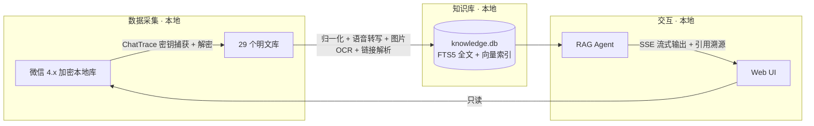

<div align="center">

# 微信知识助手

**把你的微信聊天记录,变成一个能语义搜索、带引用问答的私人知识库**

*全程本地运行 · 只读不发包 · 零封号风险*


</div>

---

## 💡 为什么需要它

几年下来,微信里沉淀了几十万条消息、文件、语音、图片和链接——那是你真实的个人知识资产。但你一定遇到过:

- 🗣️ "朋友语音里说过的一个地址",翻两百条语音还没找到
- 📄 "明明发过一份合同",只记得大概聊过,记不住原文用什么词
- 🖼️ 截图里的报错、名片、表格,微信搜索永远搜不到
- 🔗 群里分享过的文章和视频,内容既搜不到,也没法"问"
- ❓ 最关键的:**没有任何工具能回答"我和某某聊过什么"这种问题**

微信自带的搜索只能匹配准确关键词,跨不过语音、图片、链接这些媒介。本项目把它们全部补齐:

> 解密本地数据库 → 文字/语音/图片/文件/链接**全部入库建索引** → AI 问答,
> **每个答案都带 `[n]` 引用编号,点击直达原始消息、文件或链接原文**。

## ✨ 核心特性

| | 特性 | 说明 |
|---|---|---|
| 🔍 | **语义 + 全文双路搜索** | 向量检索(bge-small-zh)+ FTS5 三元分词,意思对了就能搜到,不必逐字匹配 |
| 🤖 | **带引用溯源的 RAG 问答** | Agent 自动调用 11 个工具(检索/读文件/读链接/统计…)组织答案,正文 `[n]` 可点击跳转原文,答案下方保留完整引用合集 |
| 🎙️ | **语音消息全文可搜** | Paraformer 离线转写,气泡下方直接显示文字 |
| 🖼️ | **图片内容可搜** | OCR 提取截图/照片中的文字并建索引 |
| 🔗 | **链接内容可搜可问** | 公众号正文、小红书图文(OCR)、B 站视频(字幕优先,无字幕转写音频)自动解析入库 |
| ⚡ | **实时同步** | 监听微信数据库变化,新消息约 1 秒自动入库、可检索、可问答 |
| 🛡️ | **零封号风险** | 只读本地文件,不向微信发送任何消息、不注入任何进程钩子(密钥捕获仅读取内存) |
| 📦 | **开箱即用** | 双击 `一键配置.bat`:装依赖 → 生成配置 → 自动下载模型(国内镜像)→ 自检,全程显示进度 |
| 🔁 | **一比一迁移** | 内置备份/恢复工具,换电脑时聊天记录、向量索引、媒体缓存原样搬走 |

> 作者实测规模:54 万条消息、1.8 万联系人、827 个会话,检索毫秒级响应。

## 🏗️ 工作原理



| 层 | 技术选型 |
|---|---|
| 后端 | Python 3.11 · FastAPI · SSE 流式 |
| 存储 | SQLite + FTS5(trigram)+ sqlite-vec 分区向量索引 |
| 嵌入 | bge-small-zh-v1.5(本地推理,CPU 即可) |
| 语音 | sherpa-onnx Paraformer-zh-small(离线) |
| OCR | RapidOCR(离线) |
| 解密 | [ChatTrace](https://github.com/qiaodogbear/ChatTrace)(MIT,已内置) |
| LLM | DeepSeek 等任意 OpenAI 兼容接口,不支持函数调用的模型也可用 |

## 🚀 快速开始

**环境要求**:Windows 10/11 · Python 3.11+ · 微信 4.x(本机登录过、本地有聊天记录)

```bat
git clone https://github.com/rhouselyn/wechat-knowledge-assistant.git
cd wechat-knowledge-assistant
```

然后双击两个脚本:

| 步骤 | 双击 | 它会做什么 |
|---|---|---|
| ① 初始化 | `一键配置.bat` | 安装依赖 → 生成配置并**询问 DeepSeek API key** → 自动下载模型与组件 → 逐项自检。可重复运行,已完成的步骤自动跳过 |
| ② 启动 | `启动助手.bat` | 打开 [http://127.0.0.1:8721](http://127.0.0.1:8721) |

<details>
<summary><b>命令行方式 / 分步执行</b>(点击展开)</summary>

```bash
pip install -r requirements.txt -i https://pypi.tuna.tsinghua.edu.cn/simple
copy backend\config.example.json backend\config.json    # 填入 api_key

python backend/scripts/setup.py                          # 一键配置(命令行版)
python backend/scripts/doctor.py                         # 就绪自检
python backend/server.py 8721                            # 启动

# 全新环境(无 data 备份)首次建库:
python backend/scripts/m0_decrypt.py                     # 解密微信本地库
python backend/scripts/m0_import.py                      # 解析消息入库
python backend/scripts/build_vectors.py                  # 构建向量索引
```

</details>

<details>
<summary><b>它如何找到我的微信数据?</b>(点击展开)</summary>

启动时自动定位微信 4.x 的账号目录(`xwechat_files\wxid_xxx`),优先级:

1. `backend/config.json` 的 `account.account_dir`(多账号推荐手动指定)
2. 环境变量 `WECHAT_ACCOUNT_DIR`
3. 自动扫描 `%USERPROFILE%\xwechat_files\`,取最近使用的账号

验证:`python backend/app/paths.py`

**抓取数据库密钥**(仅首次/微信更新后需要):ChatTrace 以运行时捕获方式读取密钥(24 小时有效),
具体步骤见 [项目文档.md](./项目文档.md)。

</details>

## 📦 换电脑 / 一比一迁移

`data/`(解密后的聊天记录,约 3.7GB)按设计**永不入 git**——它超过 GitHub 单文件限制,更是你的隐私。迁移用内置工具:

```bash
# 旧电脑:打包(数据库快照 + 密钥 + 媒体缓存;服务运行中也可备份)
python backend/scripts/backup_data.py D:\backup\wechat_data.zip

# 新电脑:clone → 一键配置.bat → 恢复 → 自检
python backend/scripts/backup_data.py --restore D:\backup\wechat_data.zip
python backend/scripts/doctor.py        # 全部 ✓ 后即可启动
```

## ⚙️ 常用配置(`backend/config.json`)

| 字段 | 说明 |
|---|---|
| `llm.api_key` | DeepSeek API key(必填,其余可不动) |
| `llm.model` / `thinking_model` | 对话模型 / 深度思考模型,设置页可切换 |
| `account.account_dir` | 微信账号目录,留空 = 自动发现 |
| `sync.realtime` / `realtime_sec` | 实时同步开关与轮询间隔(默认开,60s) |
| `qa.temperature` / `max_context_messages` | 问答风格与上下文长度 |

## 🔒 隐私与安全

- **数据不出本机**:解密、索引、语音转写、OCR、向量推理全部本地完成;唯一外发请求是调用你配置的 LLM API 生成回答
- **仓库不含任何隐私**:`data/`(聊天记录与密钥)、`config.json`(API key)、`models/` 均被 `.gitignore` 排除,仓库只有代码
- **只读原则**:不调用微信任何发送接口、不修改微信数据、无防撤回等高风险功能

## 🗺️ 路线图

- ✅ 一期:全量历史解密入库、语义/全文搜索、带引用 RAG 问答、语音/图片/链接解析、实时同步
- ⏳ 二期:评估微信内小号查询入口(参考 wechaty)
- ❌ 明确不做:发送消息、防撤回、朋友圈、多账号、商业化

## 🙏 致谢

- [ChatTrace](https://github.com/qiaodogbear/ChatTrace) — 微信 4.x 密钥捕获、全库解密与媒体解码(已内置,MIT)
- [sherpa-onnx](https://github.com/k2-fsa/sherpa-onnx) — 离线中文语音识别
- [BGE (BAAI)](https://huggingface.co/BAAI/bge-small-zh-v1.5) — 中文向量模型
- 调研参考:[WeFlow](https://github.com/hicccc77/WeFlow)、[chatlog](https://github.com/sjzar/chatlog)、[PyWxDump](https://github.com/xaoyaoo/PyWxDump)

## ⚠️ 免责声明

本项目仅供**个人本地数据备份与知识管理**学习研究使用。请妥善保管解密后的数据与密钥,
勿用于侵犯他人隐私、数据倒卖等非法用途;因使用不当造成的任何后果由使用者自行承担。
