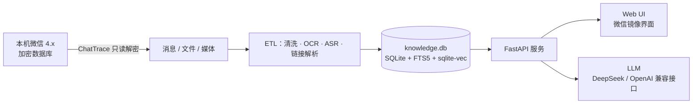

<div align="center">

# 微信知识助手

**把本机微信聊天记录变成可搜索、可引用、可问答的私人知识库。**

全程本地运行 · 只读解密 · 不向微信发送任何消息


</div>

---

## 为什么需要它

微信里沉淀着真实的个人知识：私聊结论、群里的文件、语音里说过的地址、截图里的报错、收藏的文章。但你多半经历过这些时刻：

- **语音里的关键信息找不回来**：朋友在语音里说过一个地址、电话或价格，只记得大概说过，翻两百条语音也定位不到。
- **只记得“聊过”，记不住原话**：明明发过合同、报价或方案，微信搜索却要求你准确输入当时的关键词。
- **截图和图片等于黑洞**：报错、名片、表格、二维码里的文字，微信搜索完全覆盖不到。
- **链接和文件看过就沉底**：群里分享的公众号、小红书、B 站内容，既搜不到正文，也没法直接提问。
- **信息散落在几十个会话里**：想知道“这个项目在各群里分别怎么说的”“谁最早提到这个供应商”，只能一个个群翻。
- **撤回就真的没了**：对方一句“撤回了一条消息”，重要的地址、报价或结论再也找不回来。
- **没法跨会话总结**：同一件事在私聊、群聊、文件、朋友圈里都有线索，却没有工具能一次收拢并给出带出处的结论。

微信自带的搜索只能匹配准确关键词，跨不过语音、图片、文件、链接这些媒介，也无法回答“我和某某之前聊过什么”这种问题。

这个项目把它们全部补齐：

> 解密本机微信数据库 → 把文字、语音、图片、文件、链接和朋友圈全部解析入库 → 提供语义搜索、跨会话汇总、撤回留存与带引用的 AI 问答。

你不需要手动导出聊天记录：解密、索引、OCR、语音转写都在本机完成。每个回答都会带 `[1]`、`[2]` 这样的引用编号，点击直接跳到原始消息、文件或文章正文。聊天数据只在本机读写；外发请求仅限你配置的 LLM 接口，以及解析链接/朋友圈媒体时访问对应站点。

### 你可以这样问

| 场景 | 直接提问 |
|---|---|
| 跨会话汇总 | “把最近半年各个群里关于 XX 项目的讨论按时间线整理，附上原始消息。” |
| 找源头 / 找人 | “谁最早提到这个供应商？后来在哪些会话里跟进过？” |
| 语音内容 | “朋友在语音里说过的那个地址是什么？把前后几条消息一起找出来。” |
| 文件和链接 | “把群里发过的报价单和对应的公众号文章找出来，对比一下关键条款。” |
| 链接 / 视频总结 | “把这篇文章和小红书笔记总结成要点清单，视频里的步骤单独列出来。” |

## 功能

| 能力 | 说明 |
|---|---|
| 语义 + 全文双路搜索 | 向量检索负责“意思对了”，FTS5 负责精确关键词与短词 |
| 跨会话收集与汇总 | 一次提问可跨多个群聊、私聊、文件和朋友圈检索同一主题，按时间线或人物整理并给出出处 |
| 带引用的 RAG 问答 | Agent 自动选择检索、统计、文件读取等工具；正文引用可点击溯源 |
| 语音消息转文字 | 使用 sherpa-onnx 本地离线识别，转写结果直接参与搜索和问答 |
| 图片 OCR | 截图、照片、名片、表格中的文字自动提取并建索引 |
| 链接内容解析 | 公众号、小红书、B 站链接自动抓正文；图片做 OCR；视频优先取字幕，无字幕则离线转写 |
| 链接总结与追问 | 打开任意链接即可让 AI 总结要点、提取清单或比较观点，问答按链接独立保存 |
| 自动链接中心 | 聊天里出现过的链接自动归集，可搜索、回看正文、OCR 文字和视频转写结果 |
| 朋友圈留存 | 正文、图片 OCR、评论、点赞同步入库；作者删除或“三天可见”不影响本地留存 |
| 实时同步 | 新消息通常 1 秒级进入知识库，可立即搜索和提问 |
| 撤回消息留存 | 实时同步会先把新消息入库；对方随后撤回时原文仍保留，界面标注“已撤回”，可继续查看、搜索和引用 |
| 密钥自愈 | 先用 HMAC 实测已有密钥；失效时扫描运行中的微信进程重新取钥，无需退出 |
| 本地优先 | 解密、索引、OCR、ASR 全部本地完成；不注入微信、不调用发送接口 |
| 一键迁移 | 内置备份/恢复脚本，聊天记录、索引、媒体缓存可原样搬到新电脑 |

### 链接、视频与笔记

聊天里出现的小红书、公众号、B 站和普通网页链接会自动进入左侧“链接 / 公众号”中心，不需要手动转存：

- **公众号 / 网页**：抽取标题、正文和图片，正文可全文搜索。
- **小红书**：读取笔记正文与图片，图片做 OCR；视频下载后离线转写。
- **B 站**：优先读取官方字幕；没有字幕时下载音频，用本地模型转写。
- **总结与追问**：打开任意链接，在右侧直接问 AI“总结成笔记”“提取步骤清单”“和另一篇对比”，回答会在这条链接的独立会话里保存，之后还能继续追问。

> [!NOTE]
> 链接中心会自动归集聊天中出现过的链接，因此不需要逐条“收藏”；目前没有单独的手动收藏夹或导出笔记按钮，AI 总结保存在对应链接的问答记录中。

## 架构



核心模块：

| 模块 | 职责 |
|---|---|
| `backend/app/main.py` | FastAPI API、会话/文件/链接/朋友圈、实时同步调度 |
| `backend/app/fastsync.py` | WAL 合并与页级增量解密；SQLCipher 直连导入新消息 |
| `backend/app/agent.py` | 把检索、统计、文件读取等能力包装成 LLM 工具，记录完整调用轨迹 |
| `backend/app/stream_qa.py` | SSE 流式问答：先快速检索，必要时升级为多轮 Agent |
| `backend/app/vector.py` | 本地 bge-small-zh 嵌入与 sqlite-vec 索引 |
| `backend/app/sns.py` | 朋友圈解析、永久留存、检索与媒体定位 |
| `backend/app/link_media.py` | 小红书 / B 站等链接的正文、OCR、字幕与语音转写 |
| `backend/frontend/` | 无框架的微信风格 Web UI |

## 快速开始

**环境要求**：Windows 10/11 · Python 3.11+ · 微信 4.x（本机登录过，且本地有聊天记录）

### 方式一：双击运行

1. 在 GitHub 页面选择 **Code → Download ZIP**，解压到任意目录。
2. 双击 **`一键配置.bat`**：安装依赖、生成配置、下载模型、执行自检。首次运行会要求填写一次 LLM API key。
3. 双击 **`启动助手.bat`**：浏览器打开 [http://127.0.0.1:8721](http://127.0.0.1:8721)。

### 方式二：命令行

```bash
git clone https://github.com/rhouselyn/wechat-knowledge-assistant.git
cd wechat-knowledge-assistant

python backend/scripts/setup.py        # 依赖 → 配置 → 模型 → 自检
python backend/server.py 8721          # 启动服务
```

配置脚本可以重复运行，已完成的步骤会自动跳过。非交互场景可使用：

```bash
python backend/scripts/setup.py --yes
python backend/scripts/setup.py --index-url https://pypi.tuna.tsinghua.edu.cn/simple
```

> [!TIP]
> 首次启动后，服务会在后台依次解析：聊天文字、语音转写、文件正文、图片 OCR、公众号正文和最近一年的朋友圈。进度可在设置页查看；更早的历史可以随时在设置页续跑。

> [!NOTE]
> 朋友圈历史图片解密依赖可选的 Node.js 组件；缺少时核心功能不受影响，只会显示本地已缓存的图片。

<details>
<summary><b>本机没有历史数据？</b></summary>

一键配置检测到没有知识库时，会提供两个选择：

- 从旧电脑的备份包恢复；
- 从本机微信自动建库：增量解密 → 解析 → 导入，全程无需手敲命令。

数据库密钥通过 ChatTrace 在运行时捕获，属于账号级主密钥，跨微信重启稳定。服务会定期做 HMAC 实测；万一失效，会优先尝试扫描运行中的微信进程重新取钥。

</details>

> [!NOTE]
> macOS 支持为实验性：解密、导入、检索、朋友圈等核心逻辑可运行，但需要一次性手动导入 64 位 hex 密钥，且暂不支持内存扫钥。

### 配置

`setup.py` 会在 `backend/config.json` 生成配置（该文件已被 git 忽略）。常用项：

| 配置 | 默认值 | 说明 |
|---|---|---|
| `llm.base_url` | `https://api.deepseek.com` | OpenAI 兼容的接口地址 |
| `llm.api_key` | 空 | 你的 LLM API Key |
| `llm.model` | `deepseek-chat` | 日常问答模型 |
| `llm.thinking_model` | `deepseek-reasoner` | 开启“深度思考”时使用的推理模型 |
| `account.account_dir` | 自动发现 | 微信账号数据目录；多账号时建议手动指定 |
| `qa.recent_hours` | `24` | 会话内提问默认先检索最近多少小时 |
| `sync.realtime` | `true` | 是否开启实时同步 |

## 使用

- **聊天**：左侧会话列表与微信一致；中间渲染完整消息，支持图片、语音、视频、文件、合并转发和链接卡片。
- **撤回留存**：实时同步捕获到的消息，在对方撤回后仍显示原文并标注“已撤回”，可继续搜索和引用。
- **搜索**：输入会话名过滤；回车执行全局消息搜索，结果可点击跳回上下文。
- **链接 / 公众号**：自动归集聊天里的链接，打开可看正文、图片 OCR、视频字幕或转写，并可让 AI 总结成笔记。
- **AI 问答**：右侧抽屉与“AI 助手”都是独立会话，按群聊、文件、链接分别隔离，不会串台。
- **提问方式**：`快速问答` 使用较少工具轮次（会话内 4 步、全局 6 步）；`探索模式` 使用更多轮次（8 / 12 步），适合统计、枚举、跨时段排查。
- **深度思考**：切换到推理模型，复杂问题更准，但响应更慢。
- **引用溯源**：回答中的 `[n]` 可点击跳到原消息；文件、链接、朋友圈各有独立引用样式。

## 维护命令

| 场景 | 命令 |
|---|---|
| 检查环境是否就绪 | `python backend/scripts/doctor.py` |
| 备份全部数据 | `python backend/scripts/backup_data.py D:\backup\wechat_data.zip` |
| 恢复备份 | `python backend/scripts/backup_data.py --restore D:\backup\wechat_data.zip` |
| 补漏重扫 | `python backend/scripts/rescan.py` |
| 重建向量索引 | `python backend/scripts/build_vectors.py` |
| 批量 OCR | `python backend/scripts/run_ocr.py` |
| 批量语音转写 | `python backend/scripts/run_asr.py` |
| 批量解析链接 | `python backend/scripts/index_links.py` |
| 只重建全文索引 | `python backend/scripts/rebuild_fts.py` |

> [!WARNING]
> `data/` 包含解密后的聊天记录、密钥和媒体缓存，`backend/config.json` 包含真实 API Key。两者都已在 `.gitignore` 中排除，请勿提交、上传或分享。

## 隐私与安全

- **数据不出本机**：解密、索引、OCR、ASR 全部在本地完成；外发请求仅限生成回答时的 LLM 调用，以及解析链接/朋友圈媒体时访问对应站点。
- **只读原则**：不调用微信任何发送接口，不修改微信数据库。
- **仓库不含隐私**：仓库只包含代码、示例配置和文档。
- **密钥本地保存**：Windows 下复用 ChatTrace 的 DPAPI 密钥库；macOS 下使用 Keychain 或 0600 权限文件。

## 故障排查

| 现象 | 处理方式 |
|---|---|
| 依赖安装失败 | 重新运行 `python backend/scripts/setup.py`，或加 `--index-url` 换源后重试 |
| 模型接口 401 / 403 | 检查 `backend/config.json` 中的 API Key 与模型权限 |
| 模型接口 429 | 触发限流，稍后重试或降低提问频率 |
| 模型接口超时 | 重试；复杂问题可先关闭“探索模式”或“深度思考” |
| 找不到微信数据目录 | 在 `backend/config.json` 的 `account.account_dir` 手动指定 |
| 密钥失效 / 无法解密 | 设置页查看密钥状态，必要时触发内存扫钥或重新导入 |
| 文件提示“不在本地磁盘” | 微信可能已清理缓存；可在微信中重新下载该文件 |
| 朋友圈图片缺失 | 部分历史图片依赖可选的 Node.js 解密组件，缺少时仅显示本地已缓存图片 |

## 技术栈

FastAPI · SQLite（FTS5 + sqlite-vec）· bge-small-zh 本地嵌入 · sherpa-onnx 离线语音识别 · RapidOCR 离线 OCR · [ChatTrace](https://github.com/qiaodogbear/ChatTrace) 解密（已内置）· 可选 Node.js + [WeFlow](https://github.com/hicccc77/WeFlow) wasm 朋友圈媒体解密

**明确不做**：发送消息、多账号托管、商业化；撤回留存依赖实时同步先抓到原消息，未同步到的历史撤回无法事后还原。

## 致谢

- [ChatTrace](https://github.com/qiaodogbear/ChatTrace)：微信 4.x 数据库解密与密钥捕获（MIT，已内置）
- [sherpa-onnx](https://github.com/k2-fsa/sherpa-onnx)：离线语音识别
- [BGE / BAAI](https://huggingface.co/BAAI/bge-small-zh-v1.5)：中文向量模型
- [WeFlow](https://github.com/hicccc77/WeFlow)、[chatlog](https://github.com/sjzar/chatlog)、[PyWxDump](https://github.com/xaoyaoo/PyWxDump)、[WeChatDataAnalysis](https://github.com/LifeArchiveProject/WeChatDataAnalysis)：路线调研与实现思路参考

## 免责声明

本项目仅供个人本地数据备份与知识管理学习研究使用。请妥善保管解密后的数据与密钥，勿用于侵犯他人隐私、数据倒卖等非法用途；因使用不当造成的任何后果由使用者自行承担。
